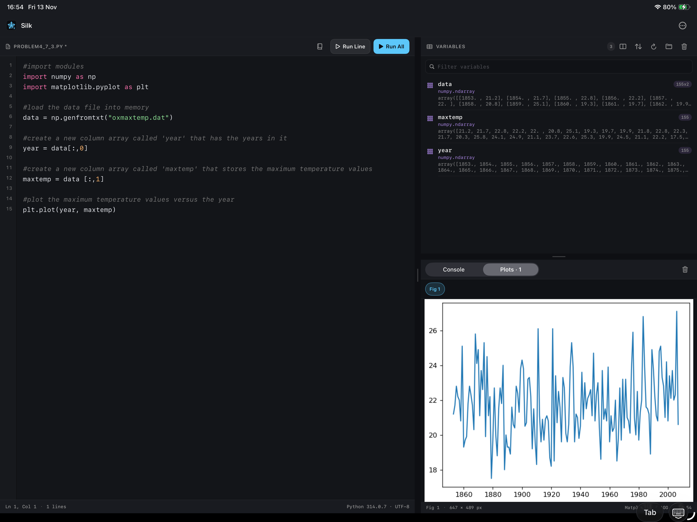
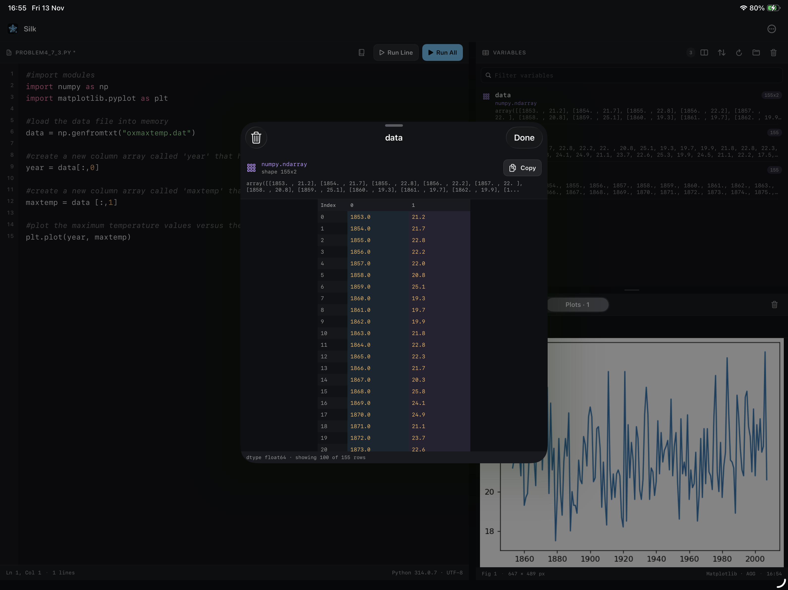

# Silk — an iPad Pyodide IDE

A three-pane, Spyder-inspired Python workspace for iPad. CPython, NumPy,
Matplotlib, SciPy, pandas and SymPy run as WebAssembly inside the app via
Pyodide — no Python binary and no server.

## Features

- **Three panes**: code editor, Variables, and a tabbed Console / Plot Explorer.
- **Adaptive layout**: side by side on regular iPad widths, stacked when narrow.
  Both dividers are draggable and the Variables bar's toggle flips the modes.
- **Execution**: Run All, Run Line or Run Selection from the editor header, the
  Run menu, or `⌘↩` / `⇧⌘↩`.
- **Error feedback**: a failed run tints the failing line, adds a gutter marker
  and status-bar badge, and shows the traceback in the console. A missing-file
  error adds an orange alert linking straight to Workspace Files.
- **Variables**: Spyder-style type colors, qualified type, shape and value
  summary; filter, sort, reload, delete, clear all, and a data-viewer sheet for
  arrays, lists, dicts and strings. Narrow layouts move these actions into the
  header ⋯ menu.
- **Workspace files**: Open/Save `.py` with the system pickers, plus a browser
  that imports CSV/NumPy/text files into Pyodide's working directory, exports
  Python-created files and deletes them.
- **Packages**: NumPy, Matplotlib, SciPy, pandas and SymPy are preloaded at boot.
- **Documentation**: a book button shows the signature and docstring for the
  callable or module under the caret, resolving from the live session or the
  file's imports.
- **File menu**: Open, Save As and Workspace Files sit in the iPadOS File menu
  (`⌘O`, `⌘S`, `⇧⌘F`).
- **Editor**: syntax colors for functions, classes, builtins, constants,
  `self`/`cls`, dunders, decorators, numbers, strings and comments (quotes inside
  comments stay comment-colored). The editor starts empty, shows the CPython
  version in its status bar, and marks unsaved edits with an asterisk.
- **Editor options**: the header ⋯ menu independently auto-completes brackets
  and quotes, inserting the pair, placing the caret inside, and stepping over
  the closing character.
- **Console**: streamed stdout/stderr, Python tracebacks, timing, copy/clear and
  a centred empty state.
- **Plot Explorer**: Matplotlib figures captured as PNG, figure chips,
  pinch/drag/double-tap zoom and pixel dimensions.
- **Runtime lifecycle**: boot progress, 180 s watchdog, failure banner with retry
  and Restart Python Runtime.

## Known limitations

- `input()` opens a single-line native prompt; there is no multi-line editor or
  piped stdin. Cancelling raises `EOFError`.
- No interrupt: use **Kernel → Restart Python Runtime**, which reloads the
  runtime and clears variables and figures.
- Variable previews are capped at 100 rows × 10 columns, are snapshots rather
  than live editable objects, and truncate long `repr` summaries.
- Workspace files live only in the current Pyodide session and reset on restart;
  imports are capped at 16 MB. There is no debugger, cell markers or
  multi-document editor.
- First run requires network unless Pyodide is bundled locally.
- Syntax highlighting is regex-based and is disabled above 120k characters.

## Screenshots

